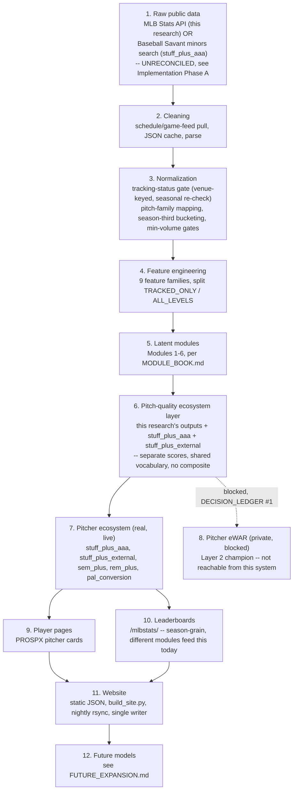

# Data Flow

Required Final Deliverable. The polished, final version of `DEPENDENCY_GRAPH.md` + `TRACKING_BRANCH_ARCHITECTURE.md`, read top-to-bottom as the single reference for "where does a number on the website ultimately come from."

## What each numbered stage actually requires, per this charter's other documents

| Stage | Governing document |
|---|---|
| 1. Raw data | `DEPENDENCY_GRAPH.md` (the two-endpoint problem) |
| 3. Normalization / gate | `TRACKING_BRANCH_ARCHITECTURE.md` |
| 5. Modules | `MODULE_SPECIFICATIONS.md`, `MODULE_BOOK.md` |
| 6-7. Ecosystem integration | `BENCHMARK_INTEGRATION.md`, `CONSUMER_AUDIT.md` |
| 9-10. Website surfaces | `WEBSITE_INFORMATION_ARCHITECTURE.md` |
| 11. Publication mechanics | `PUBLICATION_ARCHITECTURE.md`, `REFRESH_ARCHITECTURE.md` |
| 12. Extensibility | `FUTURE_EXPANSION.md` |

## Observed evidence / Inference / Speculation

Purely a synthesis diagram — no new claims. Every stage and arrow traces to a specific document listed above.

## Future work

Stage 6 → 8 (the dashed, blocked arrow) is the single most consequential open item in this entire data flow — everything upstream of it can be built and validated; nothing downstream of it can, in this environment, regardless of how much implementation work happens.
