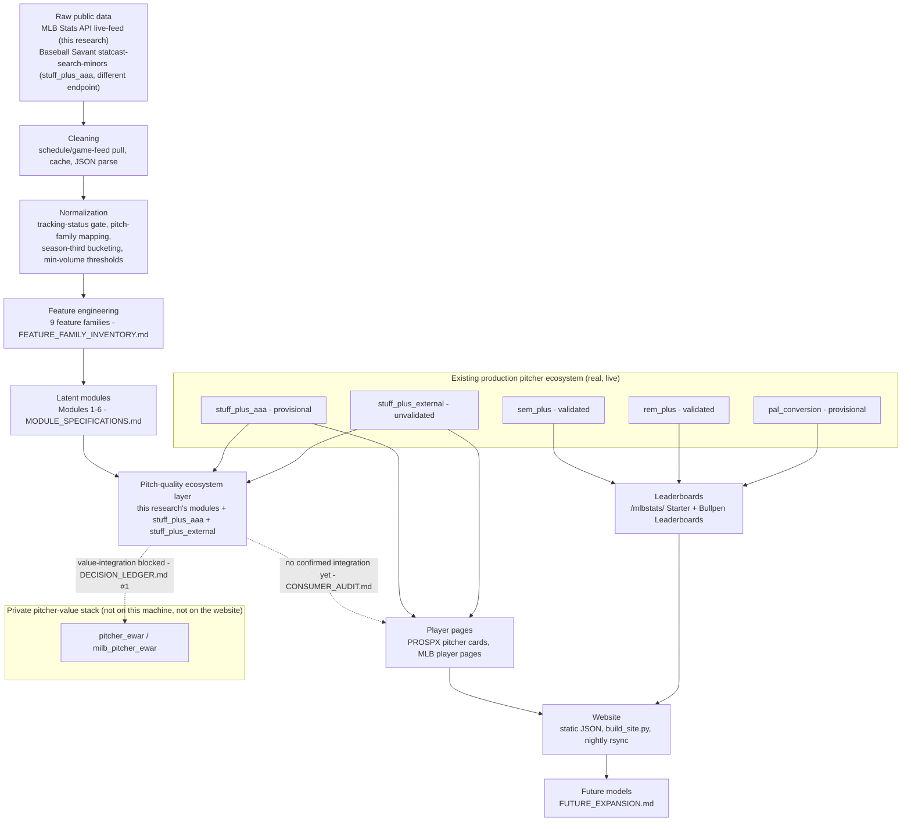

# Dependency Graph

Phase 3. The complete dependency graph from raw data to website, adapted from the charter's illustrative chain to reflect what `CURRENT_ECOSYSTEM_MAP.md` actually found — notably, "Pitcher eWAR" is not on the website's real path; `stuff_plus_aaa`/`sem_plus`/`rem_plus` are.

Solid arrows = confirmed, real paths (either already live, or directly supported by this research's own findings). Dashed arrows = not yet real — the exact gaps `CONSUMER_AUDIT.md` and `KNOWN_GAPS.md` name explicitly.

## Observed evidence

- The `RAW` node has two branches because this research's pipeline and `stuff_plus_aaa` pull from **different public endpoints** (confirmed by reading `stuff_plus_aaa.py`, `CURRENT_ECOSYSTEM_MAP.md`) — not a documentation inconsistency, a real architectural fact that must be resolved before any feature-level comparison is valid.
- `PITCHECO -> PP` is dashed because no code anywhere in this checkout currently reads this research's outputs — confirmed by the three-agent survey finding zero consumers of `milb-pitch-quality-research/`.
- `PITCHECO -> EWAR` is dashed and separately labeled because it's blocked on a different, older problem (private-export access, `DECISION_LEDGER.md` #1) than the `PP` gap (integration never having been built).

## Inference

Two structurally different kinds of "not yet connected" exist in this graph, and conflating them would be a mistake: the player-pages gap is an *integration* problem (the modules exist, nothing wires them in — solvable by writing an adapter and a wiring commit), while the pitcher-eWAR gap is a *data-access* problem (the private repo isn't on this machine — not solvable by any amount of integration work in this environment).

## Speculation

None — this is a structural diagram of already-established facts.

## Future work

Resolving the two-endpoint (`RAW`) split is the most concrete, scoped next step: either this research adopts Baseball Savant's minors search (gaining `arm_angle` and a real run-value label, losing the free schedule/venue metadata the MLB Stats API feed conveniently bundles), or `stuff_plus_aaa` is asked to additionally validate against this research's MLB-Stats-API-sourced features — either direction requires a decision outside this document's scope, flagged in `KNOWN_GAPS.md`.
