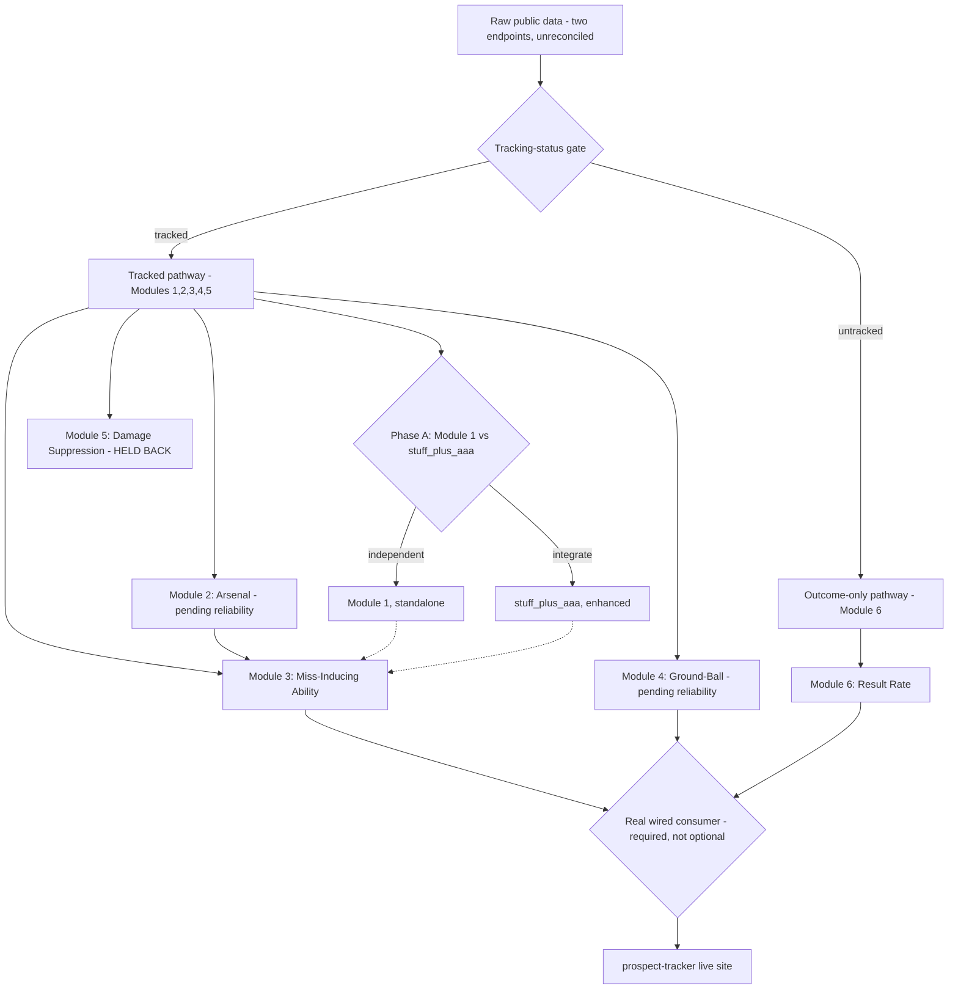

# System Architecture

Required Final Deliverable. Synthesizes `MODULE_SPECIFICATIONS.md`, `DEPENDENCY_GRAPH.md`, `TRACKING_BRANCH_ARCHITECTURE.md`, and `MODULE_INTERACTION.md` into one system-level view. Detail lives in those four documents; this is the map of the map.

## The system in one paragraph

A tracking-status-gated (not level-gated) pitch-quality subsystem, positioned as a **Layer 1 (pitch-quality/arsenal) challenger** to the already-live `stuff_plus_aaa`/`stuff_plus_external`, explicitly not attempting Layer 2 (full pitcher value, owned by the private, currently-inaccessible `pitcher_ewar` stack). Four modules are recommended for near-term implementation (Arsenal Construction, Miss-Inducing Ability × 2 variants, Ground-Ball Tendency); one (Physical Stuff) is redirected from a standalone surface toward an integration proposal for the existing `stuff_plus_aaa` model; one (Damage Suppression) is held back pending its own reliability confirmation.

## System diagram

## Five governing constraints this system satisfies

1. **Scientific correctness** — every module traces to a specific Phase 1B/1C reliability or incremental-R² number; nothing is included on predictive-performance grounds alone (`MODULE_SPECIFICATIONS.md`).
2. **Interpretability** — no universal composite; every module answers one stated baseball question (`ARCHITECTURE_COMPARISON.md`, Phase 1C).
3. **Ecosystem integration** — every module's consumer status is honestly audited, including the finding that none currently have one (`CONSUMER_AUDIT.md`) and the concrete requirement that implementation include wiring a real consumer, not just documenting an intent.
4. **Extensibility** — the tracking-status gate absorbs future tracking expansion without module redesign, tested against several concrete scenarios (`FUTURE_EXPANSION.md`).
5. **Long-term maintainability** — reuses existing infrastructure (`run_monthly.py`, `model_registry.json`, `glossary.json`, the nginx single-writer deploy model) rather than building parallel systems (`REFRESH_ARCHITECTURE.md`, `PUBLICATION_ARCHITECTURE.md`).

## Observed evidence / Inference / Speculation

This document is pure synthesis — every claim traces to one of the four cited detail documents, which in turn trace to Phase 1B/1C evidence or the ecosystem survey. No new claims are introduced here.

## Future work

See `IMPLEMENTATION_ROADMAP.md` for the concrete next phases.
