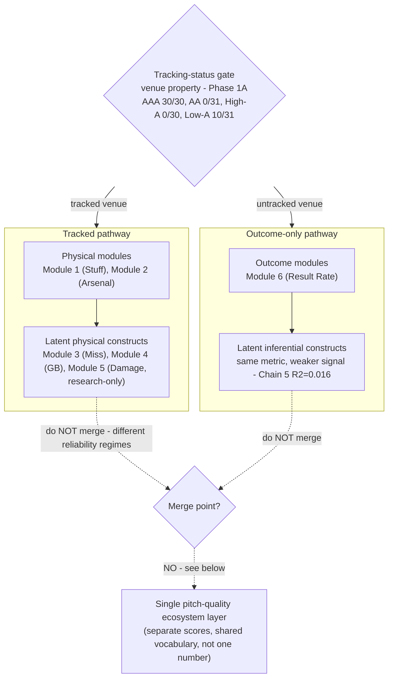

# Tracked vs. Outcome-Only Architecture

Phase 4. Formalizes the dual-path architecture Phase 1B established as evidence-required (venue-level, not level-level) and Phase 1C confirmed structurally (largely independent feature families within the tracked branch).

## Where the branches merge — and where they explicitly do not

**They do not merge into a single score.** `ARCHITECTURE_COMPARISON.md` (Phase 1C) already rejected a universal composite on redundancy/variance grounds within the tracked branch alone; merging across the tracked/outcome-only boundary would compound that mistake by averaging a well-measured signal (Module 3's tracked-population whiff rate, split-half r=0.33-0.51) with a barely-measured one (Module 6's outcome-only whiff rate, R²=0.016 from its only predictor) as if they were comparable.

**They do share**: the underlying metric definition (whiff rate is whiff rate), a common pitcher-identity join key, and — per the Website Information Architecture (Phase 11) — a shared vocabulary/glossary entry, so a reader isn't confused by two differently-named things measuring the same concept.

**They explicitly do not share**: uncertainty treatment (see below), coverage claims, or a merged production surface. A player page for a tracked-venue pitcher should show Modules 1-5; a player page for an untracked-venue-only pitcher should show only Module 6, clearly labeled as such — not a blended or imputed version of the richer branch.

## How uncertainty differs between branches

- **Tracked branch**: uncertainty is measurement-plus-sampling — split-half reliability figures exist for every module (Phase 1B), giving a defensible shrinkage/confidence basis.
- **Outcome-only branch**: uncertainty is dominated by the near-total absence of explanatory structure (Chain 5's R²=0.016) — the honest uncertainty statement here isn't just "wide confidence interval," it's "this number carries very little information regardless of sample size," a qualitatively different kind of caveat. See `UNCERTAINTY_ARCHITECTURE.md` for how this should be surfaced.

## How outputs remain comparable despite the split

They are **not** fully comparable, and this architecture doesn't pretend otherwise. What's preserved is *directional* comparability within a level (a Module-6 whiff rate of 35% still means "better than 25%" at AA) but not cross-branch magnitude comparability (a Module-3 tracked whiff rate and a Module-6 outcome-only whiff rate for the same underlying quantity are not on a reconciled, jointly-calibrated scale — no evidence from any phase supports building one yet).

## How future tracking expansion changes the architecture

This is the core extensibility test (Governing Philosophy #4). If a currently-untracked venue (e.g., an AA park) gains tracking:
1. The `GATE` node's routing table updates (one row changes; no code restructuring).
2. That venue's pitchers move from the Outcome pathway to the Tracked pathway going forward — a data-availability change, not an architecture change.
3. Historical Outcome-branch data for those pitchers is **not** retroactively upgraded or blended with new Tracked-branch data — it remains what it was, honestly labeled, per `TEMPORAL_INTEGRITY.md`'s standing rules (inherited from `milb-projections/`).

No module needs to be redesigned for this to work — this is the direct payoff of gating on tracking status rather than level, confirmed as the right call by Phase 1A/1B and preserved here.

## Observed evidence / Inference / Speculation

The branch structure and its evidence citations are Observed (traced to specific Phase 1B/1C numbers). "How future tracking expansion changes the architecture" is Inference built on the gate's designed properties, not yet tested against a real expansion event (none has occurred).

## Future work

If/when a venue's tracking status changes mid-season (not just year-to-year), the `GATE` needs a documented re-evaluation cadence — not designed yet, flagged in `REFRESH_ARCHITECTURE.md`.
