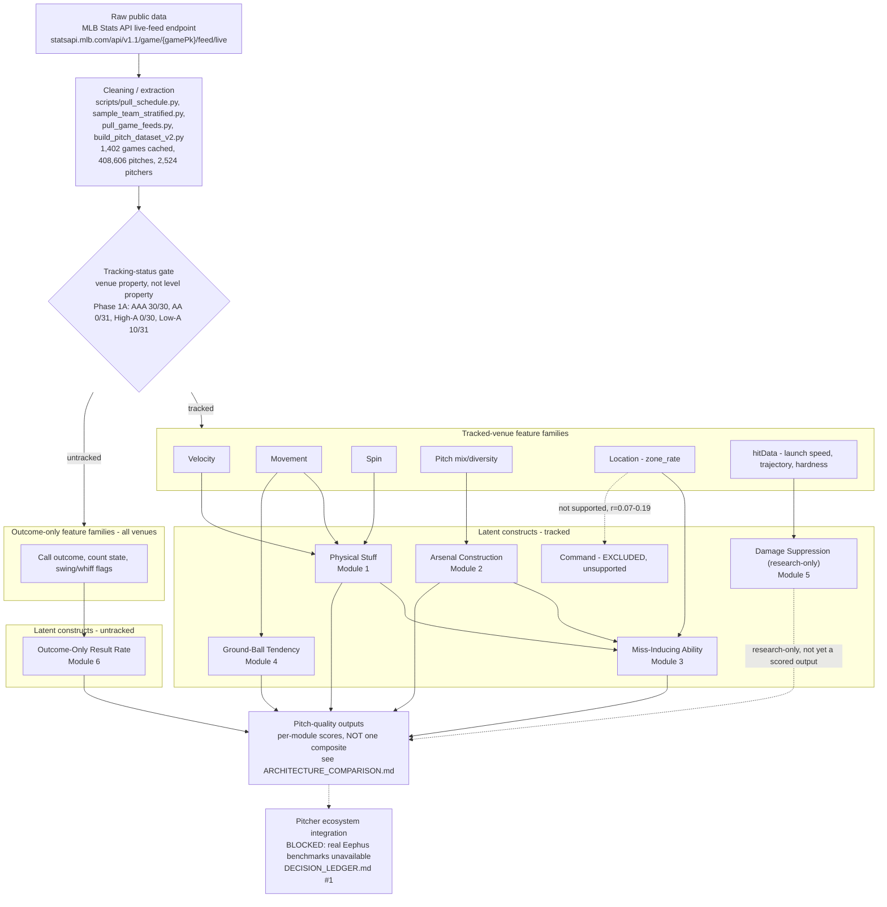

# Information Flow — Phase 1C

Deliverable 8. Complete flow from raw public data to pitcher-ecosystem integration, emphasizing clarity and traceability over any single phase's detail (each stage links to the report that established it).

## Observed evidence

Every node and edge in this diagram is traceable to a specific artifact:

| Stage | Artifact |
|---|---|
| Raw data → cleaning | `scripts/pull_schedule.py`, `scripts/phase1b/sample_team_stratified.py`, `scripts/pull_game_feeds.py`, `scripts/phase1c/build_pitch_dataset_v2.py` |
| Tracking-status gate | `reports/DATA_AUDIT_REPORT.md` (Phase 1A) |
| Feature families | `reports/phase1c/FEATURE_FAMILY_INVENTORY.md` |
| Latent constructs | `reports/phase1c/LATENT_CONSTRUCT_GRAPH.md`, `MINIMUM_ARCHITECTURE.md` |
| Production classification | `reports/phase1c/PRODUCTION_COMPONENT_RECOMMENDATIONS.md` |
| Ecosystem integration block | `milb-pitch-quality-research/DECISION_LEDGER.md` #1 |

## Inference

The flow is deliberately **not** a single pipeline — it forks at the tracking-status gate into two structurally different paths that never fully recombine (Module 6's outcome-only rate is a peer of the tracked modules, not an input to them), and it stops short of ecosystem integration entirely, blocked on a dependency (real Eephus benchmarks) outside this research's control.

## Speculation

None — this deliverable is a synthesis diagram of already-established findings, not a source of new claims.

## Future work

The `ECOSYS` node is the clearest concrete blocker in this diagram: nothing downstream of it can be built or validated until real Eephus benchmark exports are supplied, independent of how much further Phase 1 research work happens.
