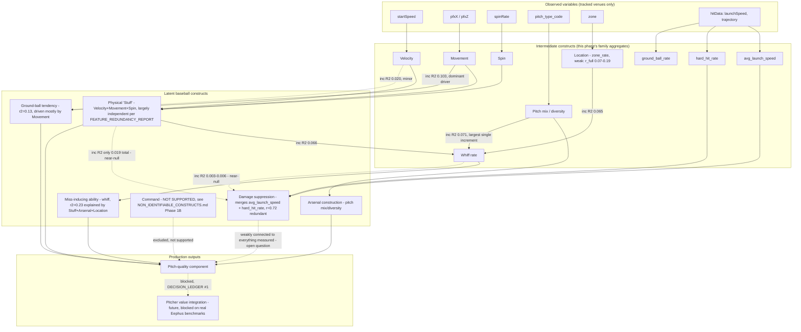

# Latent Construct Dependency Graph — Phase 1C

Deliverable 4. Observed variables → intermediate constructs → latent baseball constructs → production outputs. Emerges from Phase 1A/1B/1C evidence, not assumed in advance — edge strength annotations come directly from `INCREMENTAL_INFORMATION_REPORT.md` and `FEATURE_REDUNDANCY_REPORT.md`.

Solid arrows = supported by a meaningful incremental-R² or reliability finding this phase or Phase 1B. Dashed arrows = weak, near-null, or explicitly unsupported relationships — included so the graph doesn't silently omit tested-and-rejected connections.

## Observed evidence

- `Physical "Stuff"` is drawn as one latent construct grouping Velocity/Movement/Spin because `FEATURE_REDUNDANCY_REPORT.md` shows they're correlated-but-distinct (r=0.27-0.33 pairwise) — related enough to group conceptually, not so redundant that any one should be dropped.
- `Miss-inducing ability` sits downstream of Stuff, Arsenal, AND Location — `INCREMENTAL_INFORMATION_REPORT.md`'s Chain 1 shows all three contribute real, non-overlapping increments (Stuff cumulative 0.066, +Mix 0.071, +Location 0.065) to whiff rate, none dominating.
- `Damage suppression` merges `avg_launch_speed` and `hard_hit_rate` per their measured r=0.72 redundancy, but is drawn with dashed (weak) arrows from every upstream construct — Chains 2-3 in `INCREMENTAL_INFORMATION_REPORT.md` show total R² of only 1.9-3.7% from everything tested. This construct's connection to the rest of the graph is real but thin.
- `Ground-ball tendency` is drawn as a separate node from Damage suppression (not merged with it) because they behave completely differently against the same upstream predictors — Movement explains 10.3 points of GB-tendency variance but essentially nothing in the launch-speed/hard-hit chains. Distinct constructs, not the same thing wearing different names.
- `Command` is included only to show it was tested and rejected (Phase 1B: split-half r=0.07-0.19 at typical sample sizes) — a dashed, explicitly-labeled non-edge, not omitted silently.

## Inference

The graph has more independent branches feeding into whiff/miss-ability than a naive "Stuff → outcomes" chain would predict — arsenal construction and location each contribute as much as raw physical stuff. Damage suppression looks structurally disconnected from everything else measured in this pilot, which is itself an important structural finding, not an absence of a finding.

## Speculation

Damage suppression's weak connections to Stuff/Whiff might resolve once sequencing (unbuilt) or a defense/park-quality control (unbuilt, and blocked on real Eephus park factors — `DECISION_LEDGER.md` #1) enters the graph. Speculative, not tested.

## Future work

Add a Sequencing node once within-PA pitch order is extracted; add Command back into the graph if the larger-sample retest flagged in `IDENTIFIABILITY_REPORT.md` finds it stabilizes.
